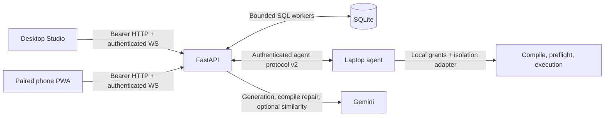

# Studio, PWA, backend, and SQLite

Both applications use `shared/client` for authenticated HTTP requests, live
WebSocket updates, request preparation, and explicit program reuse. The backend
routes controls to the registered laptop's existing validation and execution
pipeline. Public panel endpoints no longer execute stored Python on the server.



## Start and connect

Install workspaces from the repository root with `npm ci`; install backend and
agent Python dependencies with `uv sync --locked` in their respective folders.
Use Python 3.12+, Node 20.19+, and a host C compiler for the trusted test
fixtures. Native laptop controls require their platform SDKs.

Create `backend/.env` from `.env.example` without overwriting an existing file.
Configure distinct agent/controller credentials in `AGENT_DEVICES_JSON` or
`AGENT_DEVICES_FILE`, plus a Gemini credential for live generation. See
[backend–agent configuration](backend-agent.md) for the registration format.

From `backend/`:

```sh
uv run --locked uvicorn app.main:app --host 127.0.0.1 --port 8000 --env-file .env --reload
```

Alternatively use the existing `docker compose up --build -d backend` from the
root. `GET /health` returns the public service's health. The existing admin API
and Cloudflare startup configuration remain available.

From the root in separate terminals:

```sh
npm run dev --workspace frontend
npm run dev --workspace @janus/pwa -- --host 0.0.0.0 --port 5174 --strictPort
```

Studio's **Connect backend** accepts a backend origin and the laptop's
controller credential. The credential stays in window memory. An optional
`VITE_BACKEND_URL` supplies only the default address; never put credentials in
Vite variables. The PWA stores its own paired credential with its saved panel
in local browser storage. Use the existing admin device revoke operation to
revoke a phone.

The laptop runs the existing `python -m agent.main connect` command with its
own agent credential and local policy. A compiler, local job grant, and trusted
installed isolation adapter are necessary for generated execution. No native
macOS/Windows isolation adapter is included. Without one the agent returns
`VALIDATION_BLOCKED / BUILD_BOUNDARY_UNAVAILABLE`; without a grant it returns
`AUTHORIZATION_REQUIRED`. See [local authorization](backend-agent.md#local-agent-initialization).

## Publish, pair, and run

1. Add/select a Studio control. Describe its behavior in the assistant and
   choose its operation, requested capabilities, and platform libraries. The
   connected agent supplies the target platform/architecture. Preparing an
   action publishes the layout and stores its structured action template.
2. Use **Save & Push** for layout edits. The server validates the logical
   360×780 canvas, IDs, bindings, finite bounds, and non-overlap. Saves include
   the expected revision; concurrent edits return `LAYOUT_REVISION_CONFLICT`.
   Phones refresh automatically. Studio offers **Load saved panel** explicitly
   so a remote update does not overwrite unsaved work.
3. Use **Pair Device** and scan its QR in the PWA, choose **Enter code instead**
   from the home screen to enter its phone backend address and full 12-character
   code, or use **Paste pairing link**. Studio chooses the backend's existing
   HTTPS origin, its automatic Cloudflare tunnel for local connections, or an
   explicit `PUBLIC_BACKEND_URL`. **Phone backend address** can also be edited
   to a manually started tunnel's HTTPS URL. Codes last 60 seconds and are
   consumed transactionally once. Expired QR codes disappear; **New code**
   creates a fresh code. A phone gets a separate credential bound to one laptop,
   never the laptop's agent/controller credential. Its connection is saved
   before naming, and failed manual attempts preserve entered values. Phones
   cannot edit layouts or mint more pairing codes.
4. Trigger a control in Studio preview or the PWA. Both display the effective
   request, requested access, a fresh editable request ID, and reuse options.
   Slider/knob/toggle/joystick values are validated and included in the effective
   request; command/assistant text becomes the request description.
5. Configure the laptop's local grant for this fresh ID and intended operation
   before confirming. The agent reads its grant file when `connect` starts:
   enter an unused preconfigured ID, or restart the agent after adding a grant
   for the dialog's new ID. Choose **Generate and request execution**, or explicitly
   select a suggestion and choose **Reuse and request execution**. The prepared
   request hash rejects changed templates/values between review and dispatch.
   Confirmation in the browser never grants OS permissions.
6. Both clients receive live job state and authorized results. They can request
   cancellation and restore scoped history on reconnect/reload. Reconnecting
   never resubmits a job. Delayed HTTP/history updates cannot replace a later
   terminal result. Switching laptops clears the displayed scope.

All remote clients require HTTPS/WSS. A physical phone's loopback address points
to that phone; Studio warns when its phone pairing address is still loopback.
Trust the PWA development certificate for camera access, or deploy it using its
existing hosting setup. Manual address/code entry requires no camera permission.
Set optional `PWA_PUBLIC_URL` to the deployed phone app's HTTPS origin and restart
the backend to make the QR open the PWA directly from the phone's Camera app.
The launch link fills a review form; the user presses **Pair** before the code
is exchanged. Without this setting, scan the JSON QR inside the PWA. Both
origins must exclude paths, query parameters, and credentials. If a tunnel URL
changes, **Options → Pair again** updates a saved panel's connection while
retaining its name and ID; codes for a different laptop are rejected.
Set `APP_ENV` to a value other than
`development` in deployment, and configure the existing TLS proxy's trusted
forwarded scheme. Use one backend Uvicorn worker; active socket routing is local
to that process.

## Persistence and request reuse

`app/db.py` is integrated into the production startup and connected routes.
`JANUS_DB_PATH` optionally selects the database; the default remains
`backend/app/app.db` (`/app/app/app.db` in Compose). Its parent directory must
exist and be writable. Compose's existing backend bind mount preserves it.
Standalone deployment needs a persistent volume for the database and WAL
sidecars; the image intentionally excludes local databases and environment
files.

Initialization adds tables without replacing existing `devices`, `scripts`, or
`pairing_codes`. New tables persist hashed laptop credentials, phone bindings,
published layouts/revisions, action templates, scoped job views and requests,
and generated source only after the agent reports successful validation and
preflight. Environment/file registrations are imported transactionally;
existing database registrations also load without environment entries. An
existing laptop cannot be reassigned to another owner through an import.
Removing an environment entry alone does not remove its persisted registration;
manage persisted registrations deliberately. Rotating credentials in an
explicit registration import takes effect on restart.

Job IDs are unique in the persisted admission ledger, preventing replay across
backend restarts. Completed history stays available. Any unfinished persisted
job becomes `INTERRUPTED / BACKEND_RESTART`, with no assertion that local cleanup
was confirmed; it is never resumed or replayed. SQLite work uses four workers
and at most 16 admitted calls, so database operations do not run on the socket
event loop. Cancellation/shutdown waits for owned database work to finish.

Reuse candidates must match owner, laptop, operation, target, capabilities,
dependencies, and output protocol. Description exact matches use Unicode NFC
and outer trimming while preserving case, values, negations, and quoted
whitespace. Exact matches need no Gemini call. Otherwise the service locally
ranks up to 50 scoped records and asks Gemini about at most five relevant
descriptions. Source, credentials, local fixtures, runtime inputs, and laptop
files are not sent for similarity checking. Provider failures mark the check
unavailable while allowing new generation.

Suggestions never create a job or automatically reuse a program. Approved
reuse skips initial generation but repeats local compile/validation/preflight
and single-use execution under a fresh grant. Compile repair can still call
Gemini. Semantic matching is advisory; review the candidate's original request.
Provider calls share the bounded Gemini pool and deadlines with generation and
repair.

This integration carries generated jobs, results and optional built-in native
telemetry. Start `agent.main connect` with `--native-tools` for volume, mouse,
metrics and process trees, and `--screen` for screen frames. **Project → Laptop
controls starter** supplies ready-made bindings. Native data is scoped to the
registered laptop and reaches both apps; transient samples remain in memory
instead of writing every joystick/frame update into SQLite. JSON fields
from locally shared job output can drive PWA display widgets by their `source`
key. Backend host CPU/RAM is no longer broadcast as laptop telemetry.

## API contract

HTTP paths require scoped bearer credentials except the single-use pairing
exchange. Only controller credentials can use Studio mutation/pairing paths.

| Method / path | Contract |
| --- | --- |
| `GET /api/v1/studio/session` | Controller session, online state and advertised laptop target. |
| `GET /api/v1/panels/session` | Scoped controller or phone session. |
| `GET /api/layout` | `{layout, revision}` for this laptop. |
| `PUT /api/v1/studio/layout` | `{layout, revision}`; revision conflict is HTTP 409. |
| `PUT /api/v1/studio/actions/{id}` | Structured `GenerationRequest` action template. |
| `GET /api/v1/studio/actions/{id}` | Scoped configured request template. |
| `POST /api/v1/studio/pairing` | `{code, expires_in_seconds, host, pwa_url}`; public backend address and optional deployed PWA origin. |
| `POST /api/pair` | `{code, name?}` → `{deviceId, agentDeviceId, token, pcName}`. |
| `GET /api/v1/agent-jobs` | Up to 50 recent scoped persisted job views. |
| `POST /api/v1/programs/similar` | `GenerationRequest` → `{matches, checked}`. |
| `POST /api/v1/panel-actions/prepare` | Dispatch payload → effective request, request SHA-256, suggestions. No job is admitted. |
| `POST /api/v1/panel-actions/dispatch` | `{widget_id, job_id, value?, program_id?, request_sha256?}` → HTTP 202 job view. |
| `GET /api/v1/agent-jobs/{id}` | Current or persisted scoped job view. |
| `POST /api/v1/agent-jobs/{id}/cancel` | Cancel; cleanup confirmation requires a local agent reply. |

`WS /ws` authenticates its first JSON message as
`{"type":"auth","token":"<phone or controller credential>"}`. It then sends
`auth_ok`, `layout_updated`, scoped `agent_presence` and `job_update` messages,
and heartbeat `pong` replies. Optional direct control messages use
`{type:"trigger", widget, action, job_id, value?, program_id?, request_sha256?}`.
The frontends use HTTP prepare/dispatch for review and WebSockets for updates.
Tokens are never placed in URLs. Authenticated read/write frames revalidate
phone credentials, including before sending an update to a revoked phone.

Queues are bounded to 64 messages, 128 total subscribers, eight per laptop
identity, and four pending commands per socket. A slow reader is disconnected
and restores history on reconnect. Job capacity stays bounded to 16 globally
and four per device by default. Errors expose canonical reasons.

Compatibility `/api/v1/panels/pair`, `/widgets`, and `/run/{widget_id}` use the
same scoped workflow. Old unbound admin pairing codes and phone registrations
must pair again using Studio's laptop-bound code. Legacy script CRUD remains
available, but public controls do not run those scripts on the backend.

## Verification

From each Python project directory:

```sh
uv run --locked coverage run -m unittest discover -s tests
uv run --locked coverage report -m
```

Backend coverage includes all agent runtime modules, connected/job/socket/panel
routes, panel models, and `app/db.py`, with a 95% combined statement/branch gate.
The entire agent Python package retains its 99% gate. No exclusions are added.

From the repository root:

```sh
npm run build --workspace frontend
npm run build --workspace @janus/pwa
npm run lint --workspace frontend
npm run lint --workspace @janus/pwa
npx eslint --config PWA/eslint.config.js shared/client
npm run test --workspace frontend
npm run test --workspace @janus/pwa
npx playwright install chromium
npm run test:e2e --workspace frontend
```

The browser tests serve the actual production builds and use real loopback
HTTP/WebSocket connections and a temporary database. Studio publishes and runs
a control, the PWA pairs, explicitly chooses exact program reuse, both receive
live results, and the PWA reload restores its panel and history. The two
executions require one mocked generation call. The test-only agent actually
compiles/runs an exact allowlist of author-written C fixtures; its mocked
isolation flags do not prove native OS containment. It cannot execute arbitrary
or live-generated source. Additional cases cover manual address/code entry,
pasted links, PWA launch links requiring approval, immediate credential
persistence, expiry/replay, unavailable cameras, network retries, code refresh,
and laptop-scoped re-pairing. A recorded camera feed contains Studio's actual
rendered QR; Chromium runs the real `getUserMedia` and `html5-qrcode` decoding
path and exchanges the code with the real test backend exactly once.

Unit/integration tests also cover atomic pairing, expiration/revocation,
cross-owner/device isolation, credential imports, additive schema migration,
restart recovery, persistent replay rejection, layout conflicts, value/hash
validation, malformed/oversize frames, bounded queues/workers, repeated
cancellation, and shutdown during SQL admission. Live Gemini, macOS/Windows
hardware/SDKs, physical camera scanning, and the Electron runtime require their
separate integration checks.
